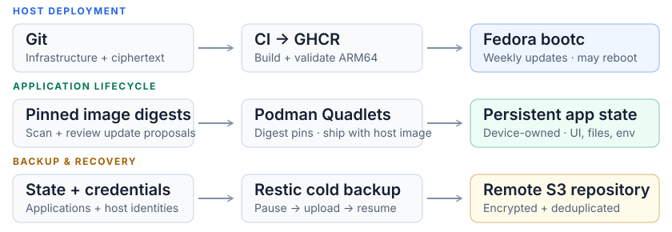

<div align="center">

# Homelab

</div>

A Raspberry Pi 4 running Fedora bootc and Podman Quadlets. Git owns deployment; the device owns application settings and data.



Application images are pinned to digests in Git; Renovate proposes updates for review and they reach the Pi with the weekly host image. Host updates require a successful full backup. The SD-card backup pauses services for the entire scan/upload, then checks readiness. A USB SSD is the recommended storage upgrade.

`configs/environment/` is reapplied at boot. `configs/defaults/` seeds missing settings once; application UI changes and local edits survive redeployment. State lives in `/var/lib/homelab/apps/<app>/`. Application secrets are staged in private per-app files under `/run`; host maintenance uses systemd credentials. Only SOPS ciphertext enters the image; the age key, S3 credentials and restic password stay root-only on the device.

Traefik and Beszel use a restricted API broker; only that broker mounts the rootful Podman socket. **The deployment is not security-clear:** upstream image vulnerabilities remain. See [security posture and limits](docs/security-audit.md).

Every app in `quadlets/`, including Home Assistant, homepage, Matter and OTBR, starts with `homelab.target`.

## Repository

| Path | Responsibility |
| --- | --- |
| `Containerfile` | ARM64 host image and packages |
| `quadlets/` | Application images, networks, routing and mounts |
| `images/` | Patched ARM64 application images (OTBR, Papra, API broker, TREK) |
| `configs/environment/` | Git-owned infrastructure settings |
| `configs/defaults/` | First-install application settings |
| `secrets/*.enc.env` | SOPS-encrypted application credentials |
| `scripts/homelab` | Preparation, secret rotation, backup, recovery and guarded host updates |
| `scripts/build-host` | Host accounts, SSH, firewall and service enablement |
| `systemd/` | Maintenance timers and application lifecycle |
| `tests/` | State preservation, recovery and API-boundary checks |

See [patched application images](docs/patched-application-images.md) for build, scan and compatibility requirements.

Read the [architecture](docs/homelab-reconciliation.md), [operations and recovery guide](docs/operations.md), and application inventories: [stateful services](docs/application-storage.md) · [infrastructure and home automation](docs/application-storage-other.md).

[Depanator](docs/depanator.md) provides Telegram apartment reviews and approval before sending, with persisted ChatGPT/IS24 login and a restore gate.

## Development

```sh
python3 -m unittest discover -s tests -v
podman build --arch arm64 --format docker --tag homelab-bootc:build .
python3 tests/verify_image.py homelab-bootc:build
python3 tests/verify_proxy.py homelab-bootc:build
python3 tests/verify_routes.py homelab-bootc:build
```

Linux is required for image builds. CI validates pull requests and blocks publication when application scans fail or report critical findings. Build, lint and generator checks complement the Pi boot, radio and restore checks in the operations guide.
